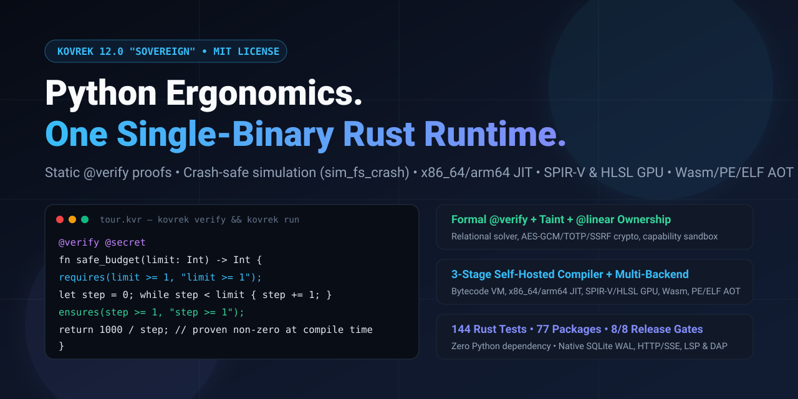

# Kovrek 12.0 "Sovereign"

<p align="center">
  
</p>

> **Python ergonomics. Single-binary Rust runtime (`8.8 MB`). Static `@verify` proofs, GPU FlashAttention/tiled GEMM (`SPIR-V` + `HLSL`), crash-safe deterministic actors, and zero-toolchain native/Wasm AOT — with zero Python dependency.**

[](https://github.com/RenegadeImmortal-777/Kovrek/actions/workflows/ci.yml)
[](https://github.com/RenegadeImmortal-777/Kovrek/releases/latest)
[](LICENSE)
[](STATUS.md)
[](docs/PACKAGES.md)
[](STATUS.md)

---

## Overview

Kovrek is a Rust-hosted programming language (`engine-rs/`) and self-hosted compiler (`compiler-kvr/`) with Python-inspired syntax and zero runtime dependency on Python. One `8.8 MB` binary provides:

- High-level language features: classes with C3 MRO and metaclasses, `@property` descriptors, `match`/`case`, async/await, closures, generators, and N-D tensors.
- Compile-time checks (`kovrek verify`): `@verify` contracts and loop invariants, `@secret`/`sanitize(...)` taint flow, `@linear` resource moves, and `@pure`/`@effect(...)` checks.
- Deterministic fault testing: virtual-clock discrete-event simulation and crash-injectable virtual filesystems (`sim_fs_crash`, `sim_partition`, `actor_node_listen`).
- Multiple backends: bytecode VM with superinstructions, `x86_64`/`aarch64` JIT, portable `SPIR-V`/`HLSL` compute shaders, standalone `.wasm`/WASI, and direct PE32+/ELF64 emission (`kovrek aot --direct`).

---

## 15-Second Tour (`@verify` + Crash Simulation + TCP Actors)

Save as `tour.kvr` and run with `kovrek verify tour.kvr` and `kovrek run tour.kvr`:

```kovrek
@secret
fn load_token() -> String { return "sk-live-secret"; }

@verify
fn safe_budget(limit: Int) -> Int {
    requires(limit >= 1, "limit >= 1");
    let step = 0;
    while step < limit { step += 1; }
    ensures(step >= 1, "step >= 1");
    return 1000 / step; // proven non-zero at compile time
}

// Deterministic fault-injectable crash simulation: keep fsync'd WAL, lose dirty writes
sim_start(42);
sim_fs_write("/wal/ckpt.json", "{\"epoch\":1}");
sim_fs_sync();
sim_fs_write("/wal/dirty.tmp", "uncommitted");
let crash = sim_fs_crash();
print("Clean tok:", sanitize(load_token()), "| Ratio:", safe_budget(10));
print("Recovered WAL:", sim_fs_read("/wal/ckpt.json"), "| Lost dirty:", crash["lost_dirty"]);
sim_stop();
```

---

## Quick Start

### Option A: One-Line Installer / Prebuilt Native Binary (Recommended)
1. **Install via one command** (downloads the verified binary for your OS from [GitHub Releases](https://github.com/RenegadeImmortal-777/Kovrek/releases/latest)):
   ```powershell
   # Windows (PowerShell)
   irm https://raw.githubusercontent.com/RenegadeImmortal-777/Kovrek/master/install.ps1 | iex
   ```
   ```bash
   # Linux / macOS
   curl -fsSL https://raw.githubusercontent.com/RenegadeImmortal-777/Kovrek/master/install.sh | bash
   ```
   Or download directly from [GitHub Releases](https://github.com/RenegadeImmortal-777/Kovrek/releases/latest) (or run `.\INSTALL.bat` on Windows from a clone).
2. Try the built-in demos right away:

```powershell
# Static formal verifier + taint + linear ownership + auto_arena
.\bin\kovrek-native.exe verify examples\sovereign\01_verify_safety.kvr
.\bin\kovrek-native.exe run examples\sovereign\01_verify_safety.kvr

# Deterministic crash-safe VFS + location-transparent TCP actors
.\bin\kovrek-native.exe run examples\sovereign\02_crash_sim_actors.kvr

# GPU tiled GEMM / causal FlashAttention / bf16 / Autograd + profiler
.\bin\kovrek-native.exe profile examples\sovereign\03_gpu_flash_autograd.kvr

# Direct native binary or standalone Wasm emission (zero C toolchain required)
.\bin\kovrek-native.exe aot --direct examples\hello.kvr hello.exe
.\bin\kovrek-native.exe wasm examples\hello.kvr -o hello.wasm
```

### Option B: Build from Source (`cargo`)
```bash
git clone https://github.com/RenegadeImmortal-777/Kovrek.git
cd Kovrek
cargo build --manifest-path engine-rs/Cargo.toml --release
cargo test --manifest-path engine-rs/Cargo.toml
```

---

## Verified Showcase Examples

Every file in [examples/sovereign/](examples/sovereign) is verified directly against [bin/kovrek-native.exe](bin/kovrek-native.exe):

| Demo | Features Exercised | Command |
|---|---|---|
| [01_verify_safety.kvr](examples/sovereign/01_verify_safety.kvr) | `@verify` loop invariants (`3` proven contracts), `@secret`/`sanitize(...)`, `@linear` resource consume, `auto_arena` escape reclamation | `kovrek verify` / `kovrek run` |
| [02_crash_sim_actors.kvr](examples/sovereign/02_crash_sim_actors.kvr) | Fault-injectable VFS (`sim_fs_sync`/`sim_fs_crash`), supervised OTP actors + TCP RPC (`actor_node_listen`/`actor_remote_ask`) | `kovrek run` |
| [03_gpu_flash_autograd.kvr](examples/sovereign/03_gpu_flash_autograd.kvr) | `gpu_kernel_inspect` (`tiled_matmul` + `attention_causal` SPIR-V/HLSL), `gpu_fused_layernorm`, `bf16` cast, reverse-mode autograd + Adam, `profile_start`/`profile_stop` | `kovrek run` / `kovrek profile` |

---

## Capabilities

| Area | Implemented & Tested |
|---|---|
| **Language** | C3 MRO multiple inheritance, `super()`, `@property`, metaclasses, stacked decorators, closures/upvalues, generators, comprehensions, structural `match`/`case`, async/await + `gather` + channels, `BigInt`/`BigDecimal`/`Complex`/`FFT` |
| **Verification & Memory** | `@verify` relational difference-bound solver (joins, loop invariants, callee `ensures`, counterexamples), `@secret`/`sanitize(...)` taint flow, `@linear` ownership across branches/actors/remotes, transitive `@pure`/`@effect(...)`, capability sandbox (`--caps`), 2-gen nursery/old-gen GC + write barriers + LIFO `arena_scope(fn)` + compile-time `auto_arena` |
| **Backends & Compiler** | 3-stage self-hosted `.kvbc` compiler (`compiler-kvr/src/main.kvr`), SSA/algebraic/DCE optimizer (`ir.rs`), in-memory `x86_64` & `aarch64` JIT (`jit.rs`), standalone `.wasm`/WASI emitter (`kovrek wasm`), direct zero-toolchain PE32+/ELF64 writer (`kovrek aot --direct`), `rustc` native AOT |
| **GPU, ML & Interop** | Vulkan SPIR-V + Direct3D 11 (`cs_5_0` HLSL) compute + multi-threaded CPU fallback, single-pass `gpu_fuse` & `gpu_fused_linear`, `groupshared` tiled GEMM, causal online FlashAttention, fused Residual+LayerNorm+activation, `f16`/`bf16` casting, N-D autograd tensors + Adam, CPython C-API + PEP 3118 + strided PyCapsule DLPack (`tensor_to_dlpack`/`py_from_dlpack`) |
| **Actors & Tooling** | OTP supervision trees (`one_for_one`/`one_for_all`/`rest_for_one`), TCP actor RPC, SplitMix64 cluster & crash-safe VFS simulation, LSP + reversible DAP (`stepBack`, forward/reverse data watchpoints), topological DAG notebooks (`kovrek notebook`), flight-recorder profiler (`profile_start`/`profile_stop`/`kovrek profile`), VS Code extension |
| **Packages & FFI** | 77 verified packages (`package-matrix.ps1`), HMAC-SHA256 signed bundles (`.kvpkg`), semver + workspaces, HTTP registry (`kovrek pkg serve`), `kovrek_plugin_v1` native `cdylib` ABI, C header struct/enum/`#define` bindgen (`kovrek ffi bindgen`), dynamic `x86_64` C-ABI `ffi_call` + bounded `mem_*` buffers |

---

## Verification & Scope

All numbers below come directly from [STATUS.md](STATUS.md) and [gate-report.txt](gate-report.txt) generated on this repo:
- **`cargo test`:** `151 passed; 0 failed` (VM, JIT, GPU, static prover, self-hosted 3-stage fixpoint, actors, sim VFS, DLPack, CPython, AOT, Wasm, and security/JIT/SSRF/FFI/sandbox hardening)
- **Package Matrix:** `77/77` packages checked and executed cleanly
- **Release Gates:** `8/8` (`cargo fmt --check`, `cargo test`, `--no-default-features`, `clippy -D warnings`, `release` build, `package-matrix`, `ecosystem-gate`, `release-check`)
- **Measured Benchmarks:** `bench_fib_jit.kvr` (`8.179 ms` best VM), `bench_tensor_matmul.kvr` (`1.025 ms` best), `bench_verify_contract.kvr` (`4` contracts / `11` invariants statically proven, `52.963 ms` best 5,000-check run) — see [benchmarks/README.md](benchmarks/README.md)

**Tradeoffs vs. mature ecosystems:** Python (PyPI), Rust (`crates.io`), and TypeScript (`npm`) have far larger package ecosystems, mature LLVM micro-architectural tuning, and vendor-tuned cuBLAS/Triton kernels. Kovrek aims to reduce multi-tool glue while remaining C-ABI and DLPack interoperable when external libraries are needed.

---

## Documentation & Contributing

- [STATUS.md](STATUS.md) — Test/gate report and module map
- [benchmarks/README.md](benchmarks/README.md) — Reproducible compute, tensor, contract verify, and AOT benchmarks
- [docs/LANGUAGE.md](docs/LANGUAGE.md) — Language syntax, contracts, actors, simulation & profiling guide
- [docs/index.html](docs/index.html) — Interactive web showcase ([examples/sovereign/](examples/sovereign) snippets)
- [docs/PACKAGES.md](docs/PACKAGES.md) & [docs/REMOTE-REGISTRY.md](docs/REMOTE-REGISTRY.md) — Package ecosystem & registry protocol
- [CHANGELOG.md](CHANGELOG.md) — Release history
- [LICENSE](LICENSE) & [docs/archive/](docs/archive/) — MIT license and archived historical records
- [CONTRIBUTING.md](CONTRIBUTING.md) — How to test, build, and contribute
